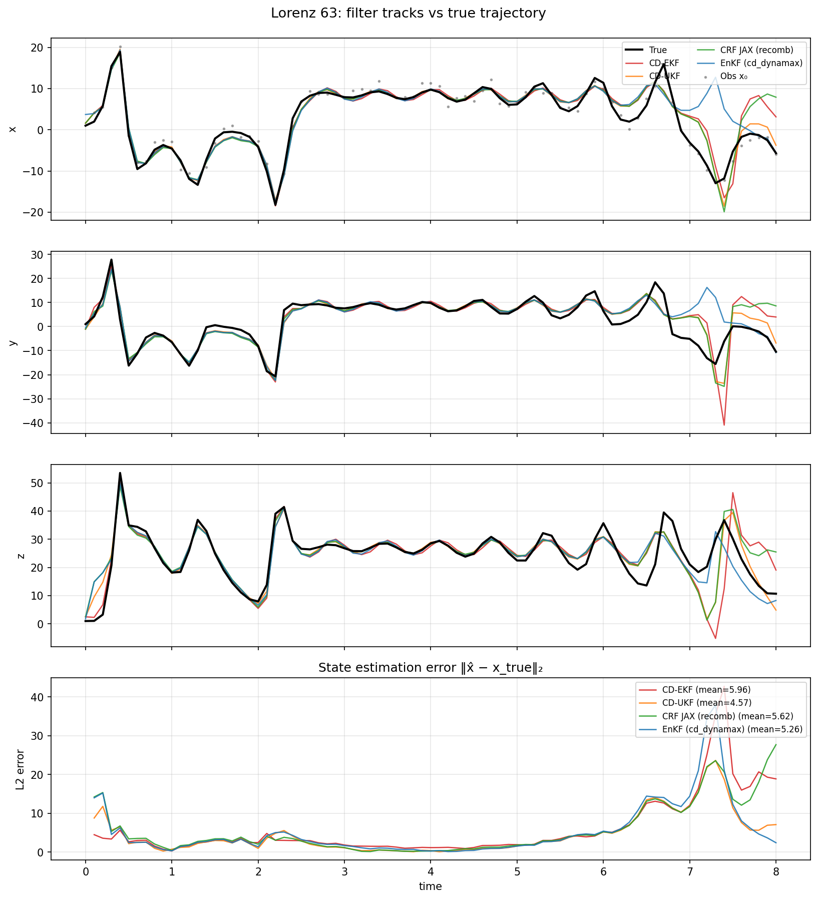

# Continuous-Discrete Nonlinear Filter Benchmarks

Benchmarks of continuous-discrete nonlinear filters built around a differentiable
**Wiener Cubature Recursive Filter (CRF)**. A shared filter/cubature library
(`wiener_cubature.py`, `cd_dynamax_enkf.py`) backs two experiments:

1. **Modified Four-Tank System (MFTS)** — the benchmark from Nielsen et al.
   (2022), *State Estimation Methods for Continuous-Discrete Nonlinear Systems
   Involving Stochastic Differential Equations*
   ([arXiv:2205.02730](https://arxiv.org/abs/2205.02730), Sec. IV).
2. **Lorenz 63 (L63)** — chaotic-attractor tracking from a single noisy
   observation channel (cd-dynamax `l63_mech_x1` style).

Both pit the CRF against the standard continuous-discrete estimators and report
tracking accuracy (MAPE / RMSE) and runtime.

## Experiment 1 — Modified Four-Tank System (MFTS)

State `x = [m1, m2, m3, m4, F3, F4]ᵀ`: four tank masses `mᵢ` [g] (ρ = 1) plus two
Ornstein–Uhlenbeck disturbance flows `F3, F4` [cm³/s], driven by known pump
inputs `F1, F2`. The dynamics are a Stratonovich SDE with two independent Wiener
drivers acting on `F3, F4`:

```
dx = f(t, x) dt + L dW,     L ∈ ℝ^{6×2},  L[5,0] = L[6,1] = σ
y_k = [h1, h2, h3, h4]ᵀ + v_k,   hᵢ = βᵢ·mᵢ,   v_k ~ N(0, meas_std²·I₄)
```

Truth simulation steps the OU mean `F̄` through 100 → 200 → 300 cm³/s over a
30-minute horizon (120 equidistant observations); estimators assume a constant
`F̄ = 150`. See the module docstring in
[`nielsen_mfts_filter_comparison.py`](nielsen_mfts_filter_comparison.py) for the
full equations and parameter tables.

Metrics: MAPE on tank masses (`MAPEx`) and disturbances (`MAPEd`), plus
time-update (TU) and measurement-update (MU) wall-clock times.

## Experiment 2 — Lorenz 63 (L63)

The chaotic Lorenz 63 system as a Stratonovich SDE,

```
dx = f(x) dt + σ dW,   f(x) = [ σ(x₂−x₁),  ρx₁−x₂−x₁x₃,  −βx₃+x₁x₂ ]
y_k = x₁ + v_k,        v_k ~ N(0, obs_noise_std²)
```

with only the first coordinate observed. A shared observation sequence is run
through CD-EKF, CD-UKF, a bootstrap particle filter (CD-DPF), the cd-dynamax
EnKF, and the Wiener CRF. See
[`l63_filter_comparison.py`](l63_filter_comparison.py) for details.

## Methods compared

- **CD-EKF** — continuous-discrete extended Kalman filter (Joseph form)
- **CD-UKF** — continuous-discrete unscented Kalman filter (stable UT)
- **CKF** — cubature Kalman filter (spatial nodes + SDE predict)
- **EnKF** — perturbed-observation ensemble Kalman filter (N = 250)
- **PF** — bootstrap particle filter (N = 1000)
- **Wiener CRF** — differentiable cubature-recursive filter (this work)

## Installation

Python 3.10+ is recommended.

```bash
python -m venv .venv
source .venv/bin/activate
pip install -r requirements.txt
```

JAX is configured for 64-bit precision inside the scripts. If you prefer to set
it via the environment instead, export `JAX_ENABLE_X64=1`.

## Usage

### MFTS

```bash
# Full benchmark (30 min, 120 observations); writes nielsen_mfts_tracking.png
python nielsen_mfts_filter_comparison.py

# Quick smoke run (shorter horizon, fewer particles)
python nielsen_mfts_filter_comparison.py --fast

# Harder regime: larger measurement noise + diffusion, no twin init
python nielsen_mfts_filter_comparison.py --noisy --show-plot

# Tune the Wiener cubature directly
python nielsen_mfts_filter_comparison.py --cubature-paths 32 --cubature-order 2
```

Useful flags (run with `-h` for the full list):

| Flag | Description |
| --- | --- |
| `--fast` | Short horizon / fewer particles for a quick check |
| `--noisy` | Higher `meas_std`, diffusion, and `P₀`; disables twin init |
| `--cubature-paths P` | Recombined Wiener paths per predict step |
| `--cubature-order K` | Lyons macro-segment cubature order (default 2) |
| `--enkf-particles` / `--pf-particles` | Ensemble / particle counts |
| `--meas-std` / `--sigma-sim` / `--sigma-dist` | Noise and diffusion scales |
| `--no-twin` | Initialize at steady state instead of the true `x₀` |
| `--plot-path` / `--show-plot` / `--no-plot` | Figure output controls |

### L63

```bash
# Default run; writes l63_tracking.png
python l63_filter_comparison.py

# Longer trajectory with custom ensemble / particle counts
python l63_filter_comparison.py --T 80 --ensemble-size 50 --dpf-particles 300
```

Useful L63 flags (run with `-h` for the full list):

| Flag | Description |
| --- | --- |
| `--T` | Number of observation steps |
| `--dt-obs` | Time between observations |
| `--ensemble-size` | EnKF ensemble size |
| `--dpf-particles` | Bootstrap particle-filter count |
| `--recombined-num-paths` | CRF recombined Wiener paths per predict |
| `--diffusion-sigma` / `--obs-noise-std` | Process and observation noise scales |
| `--plot-path` / `--show-plot` / `--no-plot` | Figure output controls |


## Outputs

**MFTS** — state tracking across all filters (`nielsen_mfts_tracking.png`):

| Method | TU [s] | MU [s] | MAPEx [%] | MAPEd [%] |
| :--- | :---: | :---: | :---: | :---: |
| CD-EKF (Joseph) | 2.525e+01 | 4.682e-01 | 9.083 | 10.455 |
| CD-UKF (stable UT) | 2.747e+01 | 3.768e-01 | 9.807 | 10.275 |
| EnKF (N=20) | 5.073e+01 | 4.398e-01 | 9.774 | 11.264 |
| PF (N=1000) | 7.659e+01 | 7.489e-01 | 8.959 | 10.480 |
| Cubature KF (2n=12, SDE) | 5.375e+01 | 2.814e-01 | 8.993 | 11.081 |
| CRF cubature (P=12) | 9.067e+00 | 1.602e-01 | 9.402 | 11.464 |


**L63** — attractor tracking from a single noisy channel (`l63_tracking.png`):




## Repository layout

| File | Purpose |
| --- | --- |
| `nielsen_mfts_filter_comparison.py` | Main experiment: model, filters, plotting, CLI |
| `l63_filter_comparison.py` | Lorenz 63 experiment: model, filters, plotting, CLI |
| `wiener_cubature.py` | Wiener-space cubature + the JAX Cubature-Recursive Filter (CRF) |
| `jax_crf.py` | Thin re-export shim over `wiener_cubature` |
| `cd_dynamax_enkf.py` | Continuous-discrete EnKF and SDE predict/update helpers |
| `examples/` | Sample output figures |

## Reference

Nielsen, K., et al. *State Estimation Methods for Continuous-Discrete Nonlinear
Systems Involving Stochastic Differential Equations.* 2022.
[arXiv:2205.02730](https://arxiv.org/abs/2205.02730).
