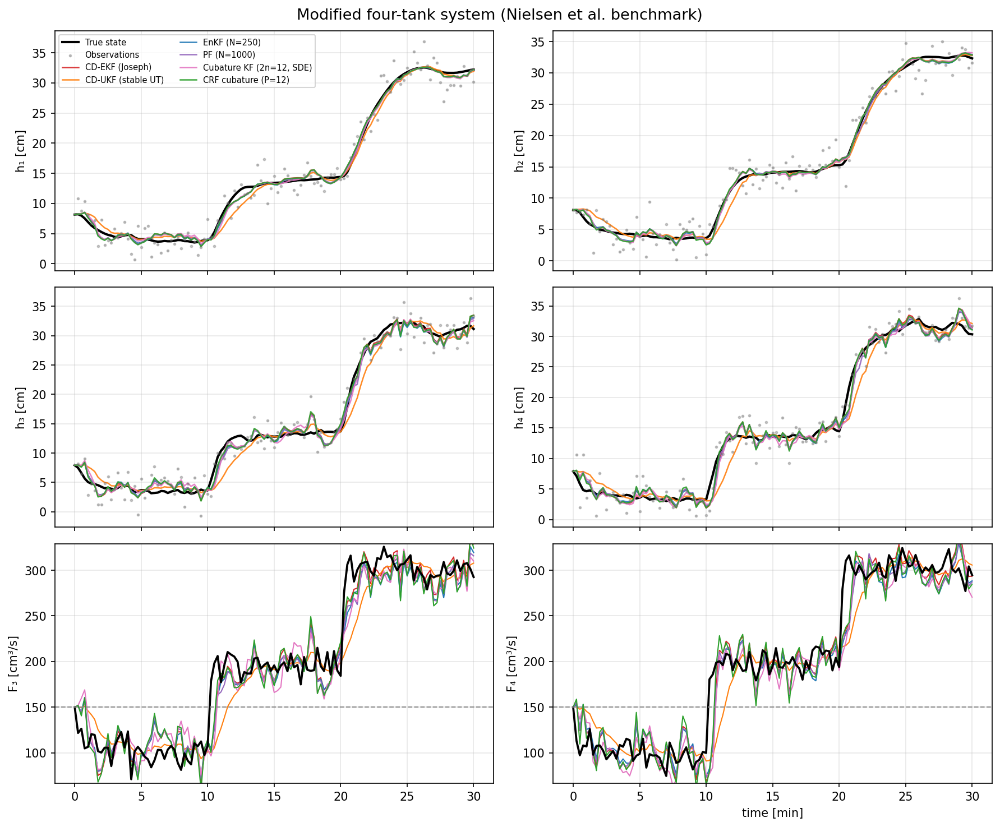

# Nielsen MFTS Filter Comparison

Benchmark of continuous-discrete nonlinear filters on the **Modified Four-Tank
System (MFTS)** from Nielsen et al. (2022), *State Estimation Methods for
Continuous-Discrete Nonlinear Systems Involving Stochastic Differential
Equations* ([arXiv:2205.02730](https://arxiv.org/abs/2205.02730), Sec. IV).

The experiment pits a differentiable **Wiener Cubature Recursive Filter (CRF)**
against the standard continuous-discrete estimators used in the paper and
reports tracking accuracy (MAPE) and runtime.

*See EXPOSITION.md for an in-depth mathematical derivation and justistification of this filter structure*

## Model

State `x = [m1, m2, m3, m4, F3, F4]ᵀ`: four tank masses `mᵢ` [g] (ρ = 1) plus two
Ornstein–Uhlenbeck disturbance flows `F3, F4` [cm³/s], driven by known pump
inputs `F1, F2`. The dynamics are a Stratonovich SDE with two independent Wiener
drivers acting on `F3, F4`:

```
dx = f(t, x) dt + L dW,     L ∈ ℝ^{6×2},  L[5,0] = L[6,1] = σ
y_k = [h1, h2, h3, h4]ᵀ + v_k,   hᵢ = βᵢ·mᵢ,   v_k ~ N(0, meas_std²·I₄)
```

Truth simulation steps the OU mean `F̄` through 100 → 200 → 300 cm³/s over a
30-minute horizon (120 equidistant observations); estimators assume a constant
`F̄ = 150`. See the module docstring in
[`nielsen_mfts_filter_comparison.py`](nielsen_mfts_filter_comparison.py) for the
full equations and parameter tables.

## Methods compared

- **CD-EKF** — continuous-discrete extended Kalman filter (Joseph form)
- **CD-UKF** — continuous-discrete unscented Kalman filter (stable UT)
- **CKF** — cubature Kalman filter (spatial nodes + SDE predict)
- **EnKF** — perturbed-observation ensemble Kalman filter (N = 250)
- **PF** — bootstrap particle filter (N = 1000)
- **Wiener CRF** — differentiable cubature-recursive filter (this work)

Metrics: MAPE on tank masses (`MAPEx`) and on disturbances (`MAPEd`), plus
time-update (TU) and measurement-update (MU) wall-clock times.

## Installation

Python 3.10+ is recommended.

```bash
python -m venv .venv
source .venv/bin/activate
pip install -r requirements.txt
```

JAX is configured for 64-bit precision inside the scripts. If you prefer to set
it via the environment instead, export `JAX_ENABLE_X64=1`.

## Usage

```bash
# Full benchmark (30 min, 120 observations); writes nielsen_mfts_tracking.png
python nielsen_mfts_filter_comparison.py

# Quick smoke run (shorter horizon, fewer particles)
python nielsen_mfts_filter_comparison.py --fast

# Harder regime: larger measurement noise + diffusion, no twin init
python nielsen_mfts_filter_comparison.py --noisy --show-plot

# Tune the Wiener cubature directly
python nielsen_mfts_filter_comparison.py --cubature-paths 32 --cubature-order 2
```

Useful flags (run with `-h` for the full list):

| Flag | Description |
| --- | --- |
| `--fast` | Short horizon / fewer particles for a quick check |
| `--noisy` | Higher `meas_std`, diffusion, and `P₀`; disables twin init |
| `--cubature-paths P` | Recombined Wiener paths per predict step |
| `--cubature-order K` | Lyons macro-segment cubature order (default 2) |
| `--enkf-particles` / `--pf-particles` | Ensemble / particle counts |
| `--meas-std` / `--sigma-sim` / `--sigma-dist` | Noise and diffusion scales |
| `--no-twin` | Initialize at steady state instead of the true `x₀` |
| `--plot-path` / `--show-plot` / `--no-plot` | Figure output controls |

## Outputs

Running the script prints a metrics table to stdout and saves a tracking figure
(default `nielsen_mfts_tracking.png`).

State tracking across all filters:



## Repository layout

| File | Purpose |
| --- | --- |
| `nielsen_mfts_filter_comparison.py` | Main experiment: model, filters, plotting, CLI |
| `wiener_cubature.py` | Wiener-space cubature + the JAX Cubature-Recursive Filter (CRF) |
| `jax_crf.py` | Thin re-export shim over `wiener_cubature` |
| `cd_dynamax_enkf.py` | Continuous-discrete EnKF and SDE predict/update helpers |
| `examples/` | Sample output figures |

## Reference

Nielsen, K., et al. *State Estimation Methods for Continuous-Discrete Nonlinear
Systems Involving Stochastic Differential Equations.* 2022.
[arXiv:2205.02730](https://arxiv.org/abs/2205.02730).
